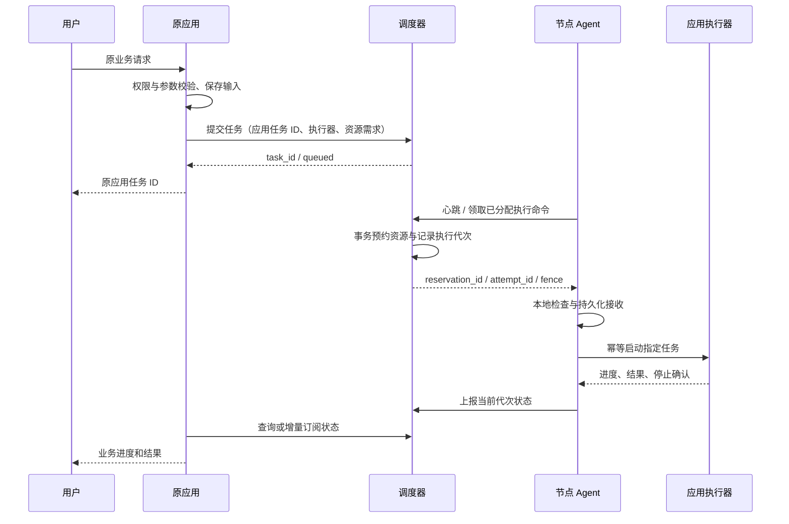
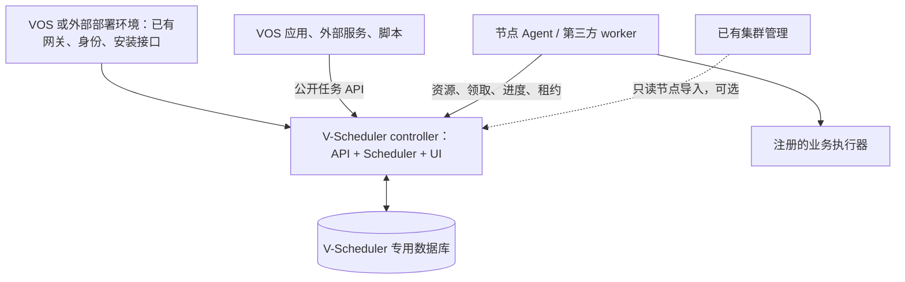
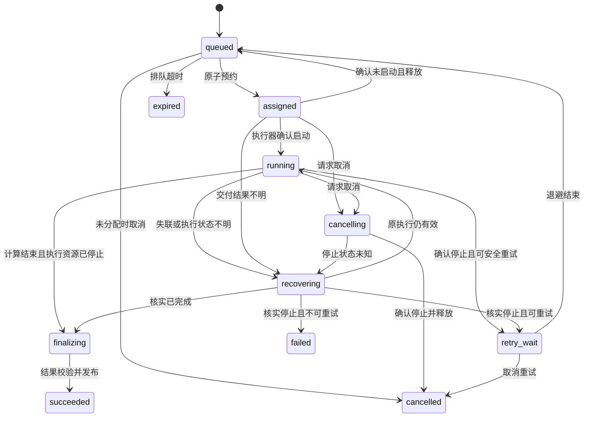

# V-Scheduler（资源调度）详细设计

更新：2026-10-14。状态：目标设计与分阶段实施；MVP 已发布，已在 tc192、tc229、tc232 的现有 VOS 环境打开验证。当前支持范围以 README、OpenAPI 和验证记录为准。部署归属：用户维护的独立应用 `apps/V-Scheduler/`，应用 ID `com.ictrek.v-scheduler`。不修改 vos-cluster-manager 或 VOS 平台代码。

本文以当前 VAI checkout 中的 VOS 源码和正式规范为依据；本地存在代码不代表目标机器已安装该能力。分阶段规划中的后续接口、状态、配置仍是提案，不是已存在的 VOS 契约；已实现范围以 README 和 OpenAPI 为准。现有架构核验见 [证据清单](architecture-evidence.md)。

## 1. 目标和关键决策

目标是让共享 CPU、内存、GPU/NPU 和常驻模型资源的任务，有序排队、按能力分配、可取消、可恢复，并解释为什么尚未执行。

关键决策：

1. 业务请求仍先进入原应用。调度器负责执行准入与资源分配，应用继续负责业务校验、用户权限、输入输出和业务结果。
2. 只纳管指定任务类型。普通页面、CRUD、文件列表和大部分轻请求保持原调用链；系统安装、升级等控制面任务保持独立。
3. 第一版只接异步耗时任务，采用单调度实例、持久化队列、节点 Agent、GPU 独占槽位。在线请求的资源准入在后续阶段加入。
4. profile 是应用局部的运行配置；跨机器匹配使用能力、执行器及其版本、动态资源。不能把同名 profile 当成等价执行能力。
5. V-Scheduler 专用 PostgreSQL 是任务、预约和执行记录的权威来源；Agent 核验本地进程与资源。已有集群拓扑可只读导入，独立节点也可直接登记，不依赖 etcd。
6. Temporal 负责获准任务的可靠多步骤编排，不独立决定资源分配，也不因自动 Activity 重试而创建重复业务执行。
7. 不承诺任意业务的 exactly-once。采用至少一次投递、幂等接收、执行代次隔离、受控重试；结果发布与外部副作用需要各自的去重机制。
8. 独立应用名为 **V-Scheduler**，中文显示名“资源调度”，应用 ID 为 `com.ictrek.v-scheduler`。Scheduler、UI、Agent、协议、打包和发布均在本仓库维护。
9. 公开版本化 HTTP API 面向 VOS 应用、非 VOS 服务、脚本及第三方 worker。接入不依赖 VAI 路径、平台 dispatcher 或 VOS 用户系统；公开是接口标准公开，任务和执行操作仍须认证授权。
10. 节点资源管理纳入 V-Scheduler：自动读取已有集群清单，复用 VOS 设备容量及 CPU/RAM/disk 使用接口；Agent 补充真实 GPU 遥测。发现、监控与执行授权分别维护，不因为发现节点就开放调度。具体实现状态、配置与阶段边界见 [节点资源管理](node-resources.md)。

第一版不含抢占正在执行的 GPU 任务、任意应用自动跨机迁移、任意 Docker/SSH 命令执行、跨集群调度、GPU 显存硬隔离或新建通用容器编排平台。

## 2. 是否所有任务都要经过调度器

**不是。纳管的任务需要统一取得资源许可，但业务数据和全部请求不必经过调度器。**

| 类型 | 路径 | 改动范围 | 管理保证 |
|---|---|---|---|
| 页面、CRUD、轻计算 | 用户 → 原应用 | 通常无需修改 | 不参与任务排队；容器预算作为背景负载 |
| 异步生成、转写、批处理 | 用户 → 原应用 → 调度器；Agent → 应用执行器 | 修改目标任务入口和执行适配器 | 统一排队、预约、取消、受控重试 |
| 在线聊天、流式推理 | 用户 → 原网关/应用 → 模型服务；执行前取得短期许可 | 修改共享网关或模型执行层，视现有链路而定 | 限流、并发槽位、与批任务共享资源预算 |
| 未改造的重应用 | 原路径；Agent 仅观察负载 | 可先不改业务代码 | 无法保证其服从全局排队，只能预留资源/独占隔离 |
| VOS 安装、升级、集群修复 | 现有平台/maintainerd 工作流 | 无需迁入业务队列 | 使用独立控制面资源预算，避免被业务队列阻塞 |

如果多个应用都调用同一受控模型服务，可以在模型服务或共享网关处统一取得许可，这些调用方可能无需修改。前提是确实只有这一执行入口，身份可识别，取消/计费等语义仍能保持。绕过该入口的任务不受此保证。

HTTP 代理可以限并发，但并不自动获得异步任务的恢复能力：请求超时后后台进程是否仍运行、如何定位和取消，都必须有执行端协议。没有这些能力的旧应用只能列为“观察模式”或“限制并发模式”，不能标记为完整纳管。

### 2.1 异步执行路径



图中 `领取` 实际采用长轮询或短轮询，调度器对在线 Agent 发放已选定节点的命令；不会向一个 profile 的所有机器广播待执行任务。业务结果仍由原应用根据自身权限向用户提供。

### 2.2 在线执行路径（后续阶段）

原网关/执行器申请 `execution permit`，成功后直接调用模型服务并流式返回；完成或取消后释放许可。调度器不转发 token、音视频或文件。许可通常绑定某个执行实例，只允许短时间等待，超过准入等待预算返回忙碌和可重试信息。

许可必须在实际执行层验证；只有调用方“承诺先申请”不能阻止其他调用方绕过。第一版不把流式请求转换成异步任务，不对已产生输出的请求自动重放。

### 2.3 V-Router 不是所有算力应用的必经层

调度器负责本机资源准入与任务/预约台账，V-Router 负责模型发现、协议转换及模型上游路由，原应用负责业务身份、输入、结果与用户界面。按**实际执行入口**而非“是否需要算力”选择路径：

| 执行类型 | 业务与资源路径 | 预约责任 |
|---|---|---|
| 原应用自有本地异步执行器（如 Image Studio 原生 sd.cpp） | 用户 → 原应用 → V-Scheduler 提交任务；Agent → 原应用执行器 | V-Scheduler 按任务持久预约；无需经过 V-Router |
| V-Router 路由的本地同步/流式模型 | 用户 → 原应用或直接到 V-Router → 本地模型服务；V-Router 在转发前向 V-Scheduler 申请 permit | V-Router 申请、续租、释放一次 permit；请求内容不经过 V-Scheduler |
| V-Router 路由的其他已纳管节点模型 | 用户 → V-Router → 其他节点模型服务；网关申请指向实际执行节点的 permit | 调度器按目标节点 Agent、执行器模板与资源池预约；远端地址不能自动算云端 |
| 已由原应用提交调度任务、执行中仍调用 V-Router | 原应用 → V-Scheduler 任务；执行器 → V-Router → 模型服务 | V-Router 对批准的该上游使用 `delegated`，核验父任务后申请不重复扣预算的关联许可；管理员须确认原任务确已持有对应资源 |
| V-Router 云端上游或不占本机资源的调用 | 原应用 → V-Router → 云端服务，或原应用直连批准的外部服务 | 不预约本机 CPU/GPU；本机预处理如有重负载须单独核算 |

V-Router 本身也可能把 Image Studio 当模型上游；此时需沿真正启动计算的入口确定唯一预约责任，避免双重预约和“Image Studio → V-Router → Image Studio”回环。不能仅因应用调用 V-Router 就把它全部任务算到 V-Router 所在节点，已纳管原生任务的子调用须核验并关联父预约。其他应用可直接实现公开任务/worker 协议，或只在共享推理入口接受 V-Router 的资源准入；不要求它们迁移业务 API 到 V-Router。

**接入顺序先做 V-Router 的本地模型入口。** V-ChatCut 等调用方只需按原方式选择 V-Router 模型；V-Router 的每个真实本地上游必须配置 `permit`，已被原应用调度的异步上游必须经管理员确认后配置 `delegated`，云端上游明确为 `cloud`。在可纳管节点上，只有确认运行实例加载了有效 `scheduler.local.json`、V-Scheduler 中存在 V-Router 服务身份与对应 executor、真实本地请求出现 permit/拒绝证据后，才可宣称该节点的 V-Router 本地模型受统一调度。新版 VOS 包声明必需应用依赖并启用缺配置时本地拒绝；已安装旧版在缺配置时仍可能沿旧路径直转，须按节点核对运行版本。之后再按 task type 接入 Image Studio 等应用自有异步执行器；这些任务仍不绕经 V-Router。资源分类和路径见 VAI [接入总览](../../../docs/vos-compute-access.md)。

## 3. 独立应用与现有 VOS 的结合

### 3.1 名称、维护边界与目录

名称 **V-Scheduler** 延续 V-Router、V-Voice、V-Music 的命名方式，并直接表达调度用途；中文显示名“资源调度”，拟定应用 ID `com.ictrek.v-scheduler`。Git 仓库为 `git@github.com:ictrektech/V-Scheduler.git`，在 VAI 中作为 `apps/V-Scheduler` 子模块维护。

所有新增实现放在 V-Scheduler；业务适配只修改用户维护且获授权接入的应用。`docs/ictrek-monorepo/` 作为现有接口的只读证据来源，本方案不在该仓库中新增源码、修改平台规范或扩展集群管理应用。

实现与后续扩展的目录边界：

```text
V-Scheduler/
├── README.md
├── docs/                 # 设计、来源、接入标准
├── api/                  # OpenAPI 和消息 schema
├── backend/              # Scheduler、身份、DB/outbox、公开 API
├── frontend/             # 独立管理 UI
├── agent/                # 节点资源、journal、执行器适配
├── adapters/             # 通用 HTTP/进程适配器
└── ictrek.app/           # manifest/compose/configs/routers、内置采集配置、发布脚本
```

独立应用的 UI 管理节点、资源、任务、配额和审计；不把集群初始化、数据库故障切换、etcd 成员管理复制进本应用。

### 3.2 现有接口复用矩阵

| 现有能力/接口 | 具体复用 | 不修改代码时的范围与限制 |
|---|---|---|
| VOS 应用安装与 configs/routers | 安装 V-Scheduler，配置 controller/node 模式和端点；注册自己的 UI | 自己定义包，不修改平台导航或集群管理 UI |
| Traefik 已有网关/服务注册 | 注册 `/app/com.ictrek.v-scheduler/api/v1`；VOS 内部由网关访问，外部由管理员配置的 HTTPS 地址访问 | 不新增平台 API；跨机须配置可信入口，不能使用另一个节点的 Docker alias |
| VOS OIDC + `/v1000/oauth2/userinfo` | VOS 内管理 UI 使用已有 OIDC Fastpath，后端核验身份 | 不能假定平台管理员身份自动等于调度管理员，须显式角色映射；非 VOS 客户端用调度应用凭据 |
| `/v1000/app/projects/manifest/list/status/deploy_async/remove_async` | 目标节点部署 V-Scheduler 自己声明的 `resource-agent` project，查询部署任务和运行状态 | 目标节点必须先安装 V-Scheduler 包，模板必须存在；操作由本机有权限管理员/应用上下文执行，不借用集群管理应用私有远程客户端 |
| 平台 async-task get/list | 只观察以上平台部署/移除运维任务 | 不提交业务计算到平台 start，不改变 dispatcher；业务排队、状态、取消全部由 V-Scheduler API 提供 |
| caps、安装 profile | 自己的安装兼容性声明；Agent 只读公开设备能力并实测资源 | 静态兼容性不等于动态空闲资源；不改宿主 caps 文件 |
| 集群管理 `/api/cluster/status`、`/api/nodes` | 可选只读导入已有节点地址/角色，经受权访问 | 不是必须依赖；管理员手工登记或 Agent 登记也能运行。导入不意味着已授权部署/执行，不读取其内部 DB/etcd 凭据 |
| 现有 PostgreSQL/共享 PGV | 使用批准的专用数据库/账号；或 V-Scheduler 自己的 PG 服务 | 不修改现有表、角色或 HA 编排。不同节点平台 PG 不视为同一台账 |
| Temporal 已有公开接入契约 | 可选连接批准的业务总线，用于复杂已获许可任务 | 单步骤第一版 DB/outbox + Agent 即可，无集群 Temporal 也能运行；不混用平台控制面工作流 |
| 共享路径 hints / Model Hub | 复用已授权的文件来源、模型注册信息 | 本地共享目录不等于跨机共享；外部客户端使用 artifact 协议 |

依据：现有服务发现、caps、projects 和 OIDC 文档及源码见 [架构证据](architecture-evidence.md)。以上接口能力可能随实际安装版本不同，Phase 0 核验只读访问与权限，不把不满足的能力变成修改平台的要求。

### 3.3 独立运行、身份和数据归属

第一版指定一个 controller 实例启用调度循环。node 模式仅提供本机 Agent 部署/状态引导，不运行第二份 Scheduler，也不复制队列数据库；安装角色采用应用配置，不与 CPU/GPU profile 混同。单机可 controller 加本机 Agent，无需创建 VOS 集群。

拟新增配置：`SCHEDULER_ROLE=controller|node`、`SCHEDULER_ENDPOINT`、`SCHEDULER_CLUSTER_ID` 和专用数据库连接配置。controller 与 node 使用同一 V-Scheduler 包，node 不需要连接调度 DB。controller 内置的本机采集器随应用自动运行，通过相同资源协议登记与上报。

数据库保存 V-Scheduler 登记的资源节点身份；已有集群成员信息只是外部只读引用。资源任务归属由调度应用自己的 workspace/app/principal 命名空间管理，不要求平台先提供多租户功能。现有 cluster ID 与 scheduler cluster ID 分别保存，避免把两个概念强行等同。

认证采用两类独立凭据：

- 管理用户：VOS 已验证 OIDC 或部署时批准的外部 OIDC，调度角色由 V-Scheduler 映射。
- 服务/worker：V-Scheduler 管理员批准的 service account 和 scope，凭据由本应用签发和轮换；服务提交只可使用其授权 workspace/app/executor。

原应用核验业务用户后以已注册服务身份提交任务。第一版访问隔离以 service/workspace 为权威；`app_task_id` 或业务 user label 是可审计标签，不能单凭标签授予用户权限。需用户级管理视图时，必须实现受信委托映射/外部身份核验，不能让 service account 自称任意平台管理员。不要求平台新增 token 签发接口。



### 3.4 Agent 怎么部署

#### 3.4.1 VOS 节点的默认部署方式

本机采集器已内置于 V-Scheduler 应用，安装后随控制器自动启动，不需要单独部署 project、填写采集凭据或运行终端命令。

首次初始化自动登记本机节点、保守容量和内部 worker 身份；重启复用节点身份与持久 journal。现有人工批准的容量不被物理容量自动覆盖。NVIDIA 配置自动启用对应容器 runtime，CPU 配置使用普通 runtime；Jetson Thor 通过 CUDA/NVML 识别统一内存。

其他执行节点的接入仍需管理员批准其身份、执行器和中心入口；网络发现不意味着获得执行权限。旧版外置采集器迁移时先保存执行器与 journal，再停止外置进程，避免两个采集会话竞争同一节点。

#### 3.4.2 非 VOS 节点与第三方 worker

外部 Linux 机器可用 V-Scheduler 发布的 Agent 容器或可执行程序，经 Docker Compose/systemd 等已有运维方式启动；配置中心 HTTPS 地址、受保护身份目录、journal 和允许的执行器。无需 VOS、projects、caps 或本仓库的目录结构。标准 worker 也可自己实现 [公开接入协议](integration-standard.md)，通过 conformance 检查后提供执行槽位。

controller 同样可按独立容器运行，VOS 是包装/身份/网关的一种部署适配；核心队列和 worker 协议不得引用 `VOS_*` 才能工作。第一版实际支持的外部 OS/加速器组合由发布矩阵声明，设计可扩展不等于已验证所有平台。

#### 3.4.3 权限与持久化

- Agent 默认通过注册执行器的本地 HTTP/Unix socket 调用，不挂 Docker socket、不 privileged，不获得节点管理员凭据。
- VOS journal/identity 位于本项目的数据根；外部 Agent 使用显式持久化目录。身份不进入诊断导出，升级/移除默认保留 journal。
- 资源探测按架构配置必要只读主机信息与设备访问；CPU-only 控制器镜像无需为了 GPU 节点复制所有模型运行时。
- 执行器拥有进程/cgroup 并实现 start/inspect/cancel/租约 watchdog；Agent 故障后执行器仍须到期停止。做不到的执行器不得宣称安全自动重试。
- 新 Agent 会话须对账旧执行，不凭 boot ID 清空预约。第三方 worker 同样受 attempt/fence 和停止确认约束。

#### 3.4.4 升级、移除和现有平台的限制

由 V-Scheduler 的管理操作/运维脚本执行：停接 → node/global drain → 等待或取消 → 确认停止与释放 → 备份必要数据 → 本机 projects remove/redeploy 或正常更新应用包 → Agent journal 对账 → ready。数据默认保留，清理是单独授权动作。

本方案不新增平台卸载守卫，不能保证管理员从原 VOS 页面直接强制卸载时会先执行 drain。对此提供应用内“准备升级/停用”检查、可核验运维步骤、启动重对账、执行器租约 watchdog；直接停机/卸载按故障恢复处理。Agent 在另一应用执行器中的任务必须能独立到期停止；不能仅靠本应用退出信号实现安全性。禁止用不存在的通用 lifecycle hook 宣称平台会自动拒绝卸载。

关闭 Scheduler 不删除现有集群 PG/Temporal/etcd，也不修改集群成员。移除资源节点只吊销 V-Scheduler 身份并移除自己的 Agent；集群节点移除由原负责人处理。

## 4. 资源模型

### 4.1 节点报告

每次报告包含 `node_id`、`agent_instance_id`、`boot_id`、递增 `report_seq`、协议版本、采集时间、能力版本和资源清单。控制器以接收时间判定新鲜度；忽略旧 boot 或乱序报告。

资源包括：

- CPU：可调度 millicores、系统预留、容器限制、实际使用率。
- 内存：容量、可调度预算、后台负载、实际使用量；单位统一 MiB。
- 独立加速器：设备稳定 ID、类型、运行时、显存预算、执行槽位。
- 共享内存加速器：引用同一 `memory_pool_id`，不得同时把 RAM 和显存当成两份可分配内存。
- 常驻模型：模型 ID/版本、所在设备、基线内存、健康状态、允许并发数。
- 执行器：应用实例、task type、契约版本、实际安装 profile、模型集合、可执行模式。
- 存储：可用输入位置、临时空间；第一版只支持已验证可访问的输入。

profile 匹配结果需同时验证安装 manifest 的兼容性和当前执行器的实测能力。静态 caps 不代表 GPU 此刻可用，也不证明驱动、模型、算子版本符合任务要求。

### 4.2 容量与记账

对每个资源池：

```text
allocatable = capacity - system_reserve - unmanaged_budget - resident_baseline
committed = 所有尚未确认释放的预约需求总量
admit = committed + new_request <= allocatable
        AND 最近观测与本地检查未触发资源压力保护
```

常驻模型基线只记一次；任务声明的是增量内存/KV cache/执行槽位。批任务如果需要装载另一模型，装载阶段也必须在预约之内；第一版只运行已有模型，不自动装卸共享模型。

观测的已用内存可能已经包含受控任务的预约，不能把“实际剩余量减全部预约”直接作为容量公式，本版为避免峰值与采样延迟，保守计算观测余量和所有未释放预约，可能提前拒绝。使用容量台账与系统保留量共同保护；无法分类的外部负载采用保守固定预算，出现异常压力暂停准入。

CPU/内存可用容器或进程 cgroup 约束；GPU 独占槽位是协作式准入，显存估计不是硬隔离。旧应用同卡运行、错误估计或常驻服务越界都可能导致 OOM。需要纳管所有该卡重执行入口，或给旧应用划分独立设备，才能声称受控任务之间不存在超额预约。

### 4.3 任务资源规格

应用注册按 task type/model/input size 分档的资源模板。提交者可以选择业务参数，不能任意降低资源要求或提高优先级；调度器根据模板校验与补全。首次纳管从保守预算开始，再通过实际峰值校准。

支持硬约束与偏好分离：硬约束含能力、版本、最小内存、设备数量、互斥组、数据可达性；偏好含已加载模型、数据本地、较小合适机器。`preferred_profiles` 只在该应用内解释，禁止作为跨应用机器标签。

## 5. 任务协议 v1（拟新增）

### 5.1 提交消息

以下 JSON 是设计示例，执行器名字为占位注册项，不能直接用于现有应用：

```json
{
  "protocol_version": 1,
  "app_task_id": "job-example-001",
  "idempotency_key": "job-example-001",
  "executor": {
    "id": "example.video.generate",
    "contract_version": "1",
    "task_type": "video.generate",
    "model_id": "example-model-v1"
  },
  "inputs": [{"artifact_id": "input-example", "sha256": "0000000000000000000000000000000000000000000000000000000000000000"}],
  "parameters": {"duration_seconds": 5},
  "placement": {"accelerator": "cuda", "preferred_profiles": ["amd", "thor-spark"]},
  "resources": {"cpu_millicores": 2000, "memory_mib": 8192, "gpu_slots": 1, "gpu_memory_mib": 12288},
  "queue_class": "batch",
  "timeouts": {"queue_seconds": 3600, "execution_seconds": 900},
  "retry_policy": {"mode": "idempotent", "max_attempts": 2}
}
```

`app_id`、`tenant_id`、`owner_id`、许可优先级从认证上下文获得，不信任请求体。参数按执行器注册 schema 校验并限制大小。输入输出是受控 artifact 引用，不允许任意本地路径或任意 URL；跨机数据授权与传输需在执行前校验。

workspace/tenant 由 V-Scheduler 管理员绑定服务身份；未启用多 workspace 时使用默认域，不要求 VOS 改账号系统。各资源模板包括 `memory_model: discrete | unified`：上述 JSON 示例仅适用于独立显存 GPU，unified 模板将 GPU 内存需求折算到唯一共享内存池，禁止重复扣减。

幂等唯一键为 `(tenant_id, app_id, idempotency_key)`；同时保存规范化请求 hash。相同键相同内容返回已有任务，相同键不同内容返回冲突。持久化去重记录的期限不得短于任务及重试窗口。

### 5.2 对应用的接口

逻辑路径如下；实际挂载前缀、错误码段和 VOS 鉴权接入在 Phase 0 冻结，响应体采用独立实现的 ResultBody 风格 envelope，字段定义以接入标准为准：

下表描述 V-Scheduler 的公开接口；统一前缀为 `/api/v1`，VOS 挂载为 `/app/com.ictrek.v-scheduler/api/v1`。不依赖平台 AsyncTaskDispatcher，完整跨环境接入标准及机器可读接口草案见 [接入标准](integration-standard.md)。

| 方法 | 逻辑路径 | 行为 |
|---|---|---|
| POST | `/api/v1/tasks` | 校验并持久化；返回 task ID、当前状态、request hash |
| GET | `/api/v1/tasks/{id}` | 返回状态、版本、进度、等待原因、当前 attempt、结果引用 |
| POST | `/api/v1/tasks/{id}/cancel` | 幂等请求取消；返回当前状态，不能提前声称已停止 |
| POST | `/api/v1/tasks/{id}/retry` | 授权手动重试；只有安全状态允许，保留历史 attempt |
| GET | `/api/v1/events?cursor=cursor` | 租户/应用范围内的增量事件；第一版轮询即可 |
| POST | `/api/v1/permits` | 已实现短期在线准入、异步桥接与关联许可 |

提交使用 HTTP 202 表示已受理；同键重复提交返回 200/原任务；状态查询为 200，权限和错误使用标准 HTTP 状态与稳定业务 code。原应用可以适配为自己的响应，不能把受理解释为计算成功。

`progress` 含 phase、percent（允许未知）、message、updated_at；默认不暴露精确完成时间。排队响应包含一个或多个稳定原因码，如 `NO_COMPATIBLE_EXECUTOR`、`WAIT_RESOURCE`、`WAIT_QUOTA`、`INPUT_UNAVAILABLE`、`NODE_UNAVAILABLE`。全局队列有多个候选集合，不提供具有误导性的唯一名次。

### 5.3 Agent 与执行器契约

Agent 采用认证出站连接，上报资源并领取本节点命令。命令含 `command_id`、`task_id`、`attempt_id`、`reservation_id`、`fence`、节点及资源池 ID、受控执行器、输入引用、有效期、trace ID。

执行适配器至少实现：

```text
start(attempt_id, fence, input_refs, parameters) -> execution_handle
inspect(execution_handle) -> running | stopped | completed | unknown
cancel(execution_handle) -> accepted
collect(execution_handle) -> staged_output_refs
```

`start` 按 attempt 幂等，同一 attempt 的重复命令返回同一 handle。`cancel accepted` 不等于 stopped；只有 `inspect` 确认结束后才能释放。Agent 在 ACK 前把命令和 handle 写入本地持久化 journal；执行器必须能在 Agent 重启后定位原任务，否则采用独立任务进程/容器包装或降级为不可安全重试。

Agent 报告携带递增序列和 attempt/fence，调度器以状态版本进行条件更新。旧执行可留审计记录，但无权改变新代次的任务状态、续租或发布结果。

### 5.4 业务映射和通知

原应用持久化 `app_task_id ↔ scheduler_task_id`；应用本地创建任务和提交调度器之间采用本地 outbox 与幂等提交。网络超时后使用同一键查询/重试提交。

调度器事件采用持久化 cursor、重复可去重、断线可补拉；原应用可先轮询，不要求新增 webhook。状态事件是业务界面投影，最终状态仍可查询校正。原应用负责把完成结果发布为业务资源；文件清理与任务终态是两个独立步骤。

## 6. 状态机与资源预约

### 6.1 任务状态



图仅表示主路径：输入/能力不可满足可在入队前拒绝；确定性执行失败可在停止后进入 failed；finalizing 可在结果发布失败后保持重试发布或进入 failed；queued 可在无兼容执行器时持续等待直至队列超时。终态含 succeeded、failed、cancelled、expired；终态资源通常已释放，异常未释放须单独显示并隔离资源，不能通过删任务消除占用。

执行超时产生停止请求，进入 cancelling/recovering；确认停止后以 `EXECUTION_TIMEOUT` 失败或按幂等策略重试，不直接进入 cancelled。取消与完成竞态以数据库条件更新决定：发布成功已提交则取消返回 succeeded；取消先获准则旧结果不得发布，仍须确认停止。

### 6.2 预约状态

```text
held → active → releasing → released
held/active/releasing → suspect → released（确认停止）或 active（恢复核验）
```

`held` 从事务分配起就计入 committed；`suspect` 也持续占用预算。预约释放是幂等事务，资源返还只执行一次；不从内存计数器恢复容量，而从未释放预约重建。

### 6.3 分配事务

每个 scheduling tick：

1. 选取按公平规则排序的一小批 queued 任务，使用任务行锁避免重复领取。
2. 找到最新在线、执行器健康、满足硬约束和输入可达的节点。
3. 按固定资源 ID 顺序锁定节点/设备资源行以及配额行，再校验容量、队列配额、节点状态。
4. 在同一事务中创建 attempt、held 预约、递增 fence、assigned 状态及命令 outbox；提交。
5. outbox 将命令交付给指定 Agent；重复交付同一 attempt 不新建执行。
6. Agent 本地二次核验。若拒绝且证明尚未启动，释放预约后重新排队；若接收结果不明，进入 recovering。

领取任务可以用 PostgreSQL `FOR UPDATE SKIP LOCKED`，但任务行锁不能代替资源池/配额锁。该语法适合队列表多消费者，不能保证严格全局 FIFO。依据见 [PostgreSQL SELECT 文档](https://www.postgresql.org/docs/current/sql-select.html)。

### 6.4 租约、代次和释放

建议初始值（需实机校准）：Agent 5 秒心跳，15 秒无新报告停止新分配；执行租约 30 秒、每 5 秒续租；启动 ACK 预算 15 秒。Agent 按本地单调时钟计算到期，不能通过节点墙上时钟决定资源安全性。接收/续租只对当前 fence 有效。

租约是有限时间执行授权，资源释放另需停止证据：

- Agent 失联时应在租约到期后发出停止并监督到实际退出；无法停止则隔离对应设备、保持 suspect。
- 控制器即使看到租约到期，也不能自动把原资源分给别的任务。
- 普通 fence 可以拒绝旧结果，却不能阻止离线 GPU 继续计算或外部副作用；重派必须先确认原执行停止，或有经验证的执行端隔离机制。
- journal 丢失/执行器无法查询时保持 unknown，等待管理员核验；安全优先于盲目恢复吞吐。
- `boot_id` 变化后核验残存容器/进程，Agent 重启不能当作任务全部停止的证据。

第一版恢复不并行运行同一任务的新旧 attempt，即使目标是另一台机器。后续只有经过副作用幂等和隔离验证的 task type 才能放宽。

## 7. 排队、配额和节点选择

### 7.1 队列规则

队列按业务类型区分 batch 与后续 interactive，能力池是动态候选集合，不为每种 profile 建完全独立、互不共享的业务队列。

1. 可执行条件过滤：节点、执行器、版本、数据、资源模板均满足。
2. 优先级限定为管理员配置的几档，应用默认 normal，提交用户不能自选最高档。
3. 每档按 tenant/app 公平轮转；第一版使用等权轮转和并发/资源配额，暂不实现复杂成本预测。
4. 每个 tenant/app 内按提交时间、task ID 排序。
5. aging：建议等待每 10 分钟提高一档，最多提升至普通业务的最高档，不能超过控制面保留等级。
6. 对当前放不下的队头任务，允许在受限窗口中查找能放下的小任务，不阻塞所有能力池。

建议大任务连续等待 30 分钟后，在一个可满足它的候选节点设“排空预约”：不再接收会阻碍它的同池批任务，等待现有执行完成。排空只有一个 owner、有有效期并重新评估候选；不得占住其余无关设备。若请求超过任何节点容量，提交时拒绝或明确等待新增节点，不靠 aging 解决。

未估计可靠运行时间时不声称 backfill 会在某一时刻腾出资源；在线短等待和批任务排空的冲突需要预设在线保留容量。

### 7.2 节点选择

从满足硬约束的节点中，按以下顺序选择：输入就绪 → 目标模型已加载 → 剩余资源最贴近需求 → 较低压力 → node ID 确定性打破平局。不会只凭 GPU 利用率最低选择机器。

同一任务使用不同架构/profile 执行必须通过兼容性验收：模型、算子、输出格式和数值容差符合契约。应用可声明仅可本机执行，第一阶段仍获得本机排队；后续逐步开放远程候选。

### 7.3 配额和常驻服务

配额至少含 tenant/app 最大 queued 数、运行槽位、CPU/内存预算、单任务上限；队列长度满时明确拒绝并提示重试，防止无限持久化积压。运行配额与预约原子更新，retry_wait 不占计算资源但计入待办额度。

常驻模型及未纳管服务预留固定预算；集群控制面另有系统保留容量。第一版不停止常驻模型来抢资源，也不暂停原业务流式响应。

## 8. Temporal 与已有队列的协调

业务排队和容量台账只由 Scheduler 决定。获准的任务可以绑定 `workflow_id = task_id + attempt_id`；命令 outbox 负责幂等启动该 workflow，workflow 中的 Activity 调用 Agent 已登记的 attempt。

长轮询的 GPU 队列使用固定并发；不得靠 Temporal Worker 的 CPU/内存自动调节推断 GPU 安全容量。官方提供固定、CPU/内存资源和自定义槽位策略，SDK 支持需核对项目实际锁定版本：[Temporal Worker performance](https://docs.temporal.io/develop/worker-performance)。

- 轻量控制 Activity 可重试查询、投递、状态协调；重试使用原 attempt ID。
- GPU 启动 Activity 重试只重复幂等 start，不能创建新进程；业务新 attempt 只能由 Scheduler 在确认旧执行停止后创建。
- 复杂任务在“取输入 → 计算 → 校验 → 发布”步骤间设恢复点。无需 GPU 的结果发布应先释放 GPU；CPU/存储若仍使用则保留对应预约，或拆为明确下一阶段。
- 任务一直在原 Celery/本地队列排队时，不应提前持有 GPU 预约。适配器要提供可立即接收的执行槽位，或把原 worker 并发及入口统一纳管；否则无法承诺队列顺序。
- Temporal 是可选适配。获授权使用现有业务总线时核验端点、namespace、SDK 与可达性；不存在兼容总线时使用单步骤执行，或由本应用独立配置总线，不要求原负责人改平台。
- 若第一版 task type 是单步骤，Agent journal + DB/outbox 可直接执行，不强制新增 Workflow；复杂步骤才复用 Temporal。两种方式都遵守相同资源和 attempt 协议。

## 9. 数据结构与一致性

拟采用独立表前缀 `vrs_`，不直接修改现有集群管理表：

| 表 | 关键内容 |
|---|---|
| tasks | 租户/应用、任务规格、幂等键/hash、状态/version、优先级、创建/超时、当前 attempt |
| attempts | 任务、代次、节点、fence、execution handle、开始/结束、失败分类、workflow 引用 |
| reservations | attempt、资源池、需求、状态、租约到期、释放证据、release version |
| resource_pools | node、device/pool ID、预算、已预约量、配置版本、排空 owner |
| node_reports | node、boot/instance、报告序列、能力、执行器、观测及新鲜度 |
| quotas | tenant/app 范围、预算、排队/预约计数 |
| outbox | 幂等命令 ID、接收方、payload、投递/ACK、下次重试 |
| events | 全局递增 cursor、任务、版本、事件类型、可见范围、审计摘要 |
| artifacts | 受控输入输出引用、校验和、任务/attempt、暂存/发布/清理状态 |

唯一约束：任务幂等键、attempt 序号、command ID、每个 attempt 的唯一启动记录；设备 fence 单调增加并持久化。状态变化使用 `WHERE version = expected` 条件更新。资源表锁顺序固定，死锁/序列化失败有限重试。

事件、状态和 outbox 在同一数据库事务提交，避免“已经预约但丢掉派发消息”。outbox 长期未交付不能直接释放可能已经启动的预约，先走恢复核验。数据库故障时停止准入；Agent 最多执行到已获租约期限，随后停止与核验。

结果先写 attempt 独立暂存位置，校验后仅当前 attempt 通过数据库条件更新发布指针。若业务还要发送消息、扣费或调用外部系统，用业务幂等键/业务 outbox；无法去重的副作用任务默认禁止自动重试。

## 10. 故障恢复与运维操作

| 故障/事件 | 自动动作 | 重试/释放门槛 |
|---|---|---|
| 应用提交响应丢失 | 原键重试/查询 | 返回原 task，不新增 |
| 事务提交后调度器崩溃 | 从 outbox 重投 | 同 attempt start 幂等 |
| 命令 ACK 丢失 | Agent journal 查询/重复交付 | 未确定启动前不得另派 |
| Agent 重启 | 读取 journal，枚举 execution handle，核对 boot/fence | 续跑、收集完成结果或确认停止 |
| 节点网络分区 | 停派，任务 recovering、预约 suspect | Agent 停止证据或受控外部隔离核验 |
| 计算进程崩溃/OOM | 确认退出，记录资源峰值 | 幂等任务可退避；同规格 OOM 不无限重试 |
| 调度数据库不可用 | 停止提交受理/新准入及续租 | 存活租约到期停止；恢复后逐条核验 |
| Temporal 不可用 | 编排任务保留待投递/恢复状态 | 单步骤已获许可执行按租约；不可创建第二工作流 |
| 任务执行超时 | 取消并监督进程退出 | 确认停止后按策略 failed/retry_wait |
| 输出已写、成功回报丢失 | 查暂存和执行状态，幂等发布 | 当前 attempt/fence 与校验和有效 |
| 输入失效/无权限 | 明确失败原因 | 不自动重试永久错误 |
| 维护/升级 | node drain，停止新分配，等待或授权取消 | 活跃预约清零且核验后升级 |
| Agent journal 丢失 | 隔离资源、展示 unknown | 管理员核验；禁止自动清空台账 |
| 旧应用绕过执行入口 | 资源压力触发暂停准入 | 限额/隔离或完整接入后恢复保证 |

重试分类：瞬时执行器不可用/可验证崩溃可重试；参数、权限、版本、无法满足的资源请求不重试；外部副作用未知进入人工核验。建议指数退避加 jitter，初始 5 秒，上限 5 分钟，max_attempts 默认 2（含首次），模板可覆盖。排队超时与执行超时独立，整个任务还需绝对截止时间避免重试延长无限等待。

管理操作包括暂停/恢复队列、node drain、调配配额、取消、授权重试、核验 suspect。强制释放必须有“进程停止/设备隔离”的证据，记录操作人和理由；UI 不提供无条件“一键清空占用”。

## 11. 鉴权、协议演进和可观测性

- 原应用校验业务用户；调度提交用 V-Scheduler 注册的服务身份，调度器校验 workspace、app、task type 与 scope，业务用户标签不能充当授权依据。
- 平台 async-task API 仅用于既有运维部署任务观察，其当前权限语义不作为业务任务隔离依据。V-Scheduler 自己实现任务/事件的 scope 与所有者授权，不修改平台 API。
- Agent 绑定 cluster/node 身份，凭据可轮换；不把现有节点管理员凭据转发给业务执行器。
- 能力注册只接受受信 Agent 与已批准执行器；命令有签名/受认证传输保护，不能由用户指定执行端地址。
- artifact 使用权限受限的传输引用，输出下载仍经原应用授权；日志/事件只记录必要元数据，默认不记录业务 prompt、文件内容或凭据。
- v1 协议固定字段语义，未知必需版本拒绝；可选能力通过握手声明。滚动升级先升级兼容接收端，再升级发送端；执行器旧版本有活跃任务时保留。
- trace 链使用 app_task_id、task_id、attempt_id、reservation_id、workflow_id；不靠日志解析恢复状态。

UI 至少提供：节点容量/已预约/实测三栏，设备与常驻模型，排队任务及等待原因，运行/恢复/取消中任务，attempt 历史、审计、维护模式。观测指标包括 queue wait P50/P95、最长等待、预约利用率、设备压力、拒绝原因、重复命令数、suspect 资源时长、停止耗时、结果发布延迟。

## 12. 应用改造清单与渐进接入

| 接入级别 | 改造内容 | 能得到什么 |
|---|---|---|
| L0 观察 | Agent 监控，划定旧应用预算 | 全局资源可见；无全局排队保证 |
| L1 准入 | 在共享执行入口加槽位许可及取消确认 | 并发保护；不自动获得持久任务恢复 |
| L2 异步纳管 | 原任务入口提交协议、ID 映射、幂等执行、inspect/cancel、结果适配 | 持久排队、进度、取消、受控恢复 |
| L3 跨机执行 | 解耦本机路径、输入传输、模型/版本适配、不同架构验收 | 全集群候选选择和数据/模型亲和 |

第一批只选一个已经有 job ID 和异步进度的任务类型。保留原应用 frontend 和外部业务接口，内部把原后台启动改为提交调度器；如果执行逻辑可提取为 worker/适配器，尽量复用。真正受控的启动接口禁止绕过许可，避免原入口和新入口同时启动。

原应用切换使用按 task type 的 `observe / scheduled / legacy` 配置；由管理员控制，不能按网络故障自动降级为 legacy。调度器不可用时，scheduled 任务由应用 outbox 保留待提交或明确返回暂不可用，不直接抢 GPU。

### 12.1 Image Studio 的具体接入切口

源码依据见 [证据清单第 2 节](architecture-evidence.md#2-image-studio-接入证据与最小改动边界)。建议以本地 sd.cpp 生成分支作候选试点，最终由 Phase 0 实机能力验证决定：

1. 保留 `POST /generate`、输入校验、模板、历史及结果访问方式。
2. 将 `generation.py` 的本地 `asyncio.create_task(run_job(...))` 改为持久提交调度任务；原 Semaphore 可作为执行器内防御，不能继续作为独立资源权威。
3. 复用 sd.cpp 启动/取消实现，新增可持久定位的 execution handle、inspect、重复 start 去重与停止确认。
4. 保存 `job_id ↔ task_id`，原查询返回调度状态投影，取消委派给调度器；远端输出先回应用受控存储再发布。
5. 调整启动时把 queued/running 一律标失败的逻辑：scheduled 任务应查询调度权威状态，网络不可达时标“核验中”，不得宣告远端计算失败。
6. V-Router 分支暂保留原路径；它的实际计算可能在别的服务或外部供应商，不能简单预约 Image Studio 宿主机的 GPU。若共用同一设备须把真实执行端纳管，或划分固定预算。

这意味着“不是所有应用都要改”，也不意味着试点只需替换一行：可靠恢复仍需要 ID 映射、执行器生命周期、取消及结果协议。前端是否需要调整取决于原状态枚举能否表达排队/核验/取消中，Phase 0 核验后只改必要显示。

### 12.2 按业务入口逐步接入的执行清单

先登记“应用 ID + task type + 执行位置 + 接入级别”，不以整应用一键切换；同一应用可同时包含普通 CRUD、自有批任务和外部模型调用。

| 应用现状 | 第一处改动 | 后续必要改动 | 保持原样的范围 |
|---|---|---|---|
| 现有业务流程调用平台/Temporal | 在用户维护的业务后端或可修改 Activity 中直接接入公开 API，不改平台 dispatcher | 单一执行权威、ID 映射、幂等执行/取消；无法修改的类型先观察 | 原平台工作流和未接入类型；不承诺平台统一列表包含调度任务 |
| 自有 asyncio/Celery/后台线程队列 | 原创建 job 后的启动接缝改成 outbox 提交 | job ID 映射、队列互斥切换、重启对账、执行器停止确认 | 参数校验、历史数据、原查询/取消的外部路径 |
| 多应用共用同一推理执行端 | 在真正执行端增加资源准入，客户端可先不改 | 绑定调用身份、并发槽位、取消；需异步恢复时再引入 job 协议 | 业务调用链及流式数据传输 |
| 调用外部 API 的应用 | 默认不预约本机 GPU | 后续可按供应商限流单独建能力池，实际本机预处理另算 | 外部调用与结果路径；不虚构本地加速器消耗 |
| 无安全 inspect/cancel 的旧应用 | 先观察或固定隔离设备 | 补齐可定位执行 handle 和停止协议后才能 L2 | 原功能继续运行，明确不受统一重试保证 |

每个 task type 的切换检查单：

1. 观察：采集资源峰值和常驻预算，确认真实执行节点、共享设备和旁路入口。
2. 注册：批准执行器契约、资源模板、模型/版本、认证身份；先限制为同机候选。
3. 验证：在测试环境执行重复提交、ACK 丢失、取消、重启和结果发布故障；不能只看 UI 进度。
4. 切换：暂停该类型旧队列接收，等待/取消旧 job 并确认退出，再开启 scheduled；原任务历史可查询。
5. 扩展：第二节点核验模型/输入可达性与输出容差，通过后开放跨机；第二应用复用协议和模板注册，不复制调度算法。
6. 回退：执行第 12 节 drain 规则。调度不可用不自动直跑，未完成 job 保留在原应用 outbox 或调度队列。

VOS 和非 VOS 新应用均可按公开协议接入耗时入口；已有轻应用和 VOS 控制面无需迁移。业务应用无需直接调用 Agent 的部署/领取/执行内部接口。

回退步骤：停接新 scheduled 任务 → drain/cancel 并核验旧 attempt → 保留记录及结果映射 → 关闭该 task type 新入口 → 启用原 worker。未清空活跃预约时不得双开旧 worker。数据库迁移采用新增表/字段，回退不删除任务历史。

## 13. 分阶段实施计划

| 阶段 | 工作与交付物 | 验收门槛 | 回退方式 |
|---|---|---|---|
| Phase 0：契约冻结 | 核验现有接口、V-Scheduler 包契约、OIDC/服务身份；选试点；冻结公开 API、worker 协议、模板、数据/停止方式 | 无需修改平台或集群管理代码；明确 L2/L3、部署矩阵和所有未知项 | 只读核验 |
| Phase 1：观察与台账 | 独立 V-Scheduler 后端/UI、controller/node 模式、内置本机采集；外部 Agent 启动说明、服务身份登记 | 包/模板未安装时正确拒绝；持久 journal；ready 与 healthy 区分；外部节点不依赖 VOS | 停 Agent，保留数据 |
| Phase 2：单机接入 | 先在 V-Router 的本地模型入口验证 permit/delegated、服务身份及忙碌拒绝；再对 Image Studio 自有异步任务实现 DB/outbox、公开提交、停止 watchdog 与应用内 drain；不改平台 dispatcher | V-ChatCut 等经 V-Router 选择本地模型时有唯一预约，云端仍直达；异步试点 20 并发串行、重复提交/命令只启动一次、取消/超时确认停止再释放、禁旁路启动 | 按第 12 节 drain；未确认停止的预约继续保留 |
| Phase 3：恢复与跨机 | Agent journal、故障注入、租约/fence、两节点执行；输入输出传输；必要 Temporal 编排 | 不同能力节点正确选择；分区不重复运行；控制器/Agent 重启恢复；旧结果不能覆盖；跨架构输出合格 | 禁用远程候选，保留单机纳管 |
| Phase 4：公平与多来源 | 第二个应用、非 VOS 提交者/worker、接入认证测试、配额/aging/排空、常驻预算 | 无 VAI 路径/VOS JWT 依赖；版本/权限/幂等/取消 conformance 通过；公平与容量成立 | 按接入方 drain 回退，保留基础配额 |
| Phase 5：在线公平与 HA | 在现有短期 permit 上增加批/在线保留容量、流式执行端停止适配；多控制器领导权与 failover | 在线延迟达到约定 SLO；流式不中途重放；HA 切换不重复执行；数据库恢复过程可复现 | 在线回原链路需独立预算，控制器回单实例 |

### 13.1 参考设计的增量吸收（2026-10-14）

以下六份飞书材料用于提炼需求，并非 V-Scheduler 的实现契约。文档中 Celery、Redis Stream、按“设备 × 算法”创建队列和单独的状态服务，是其原方案的技术选型；本应用继续使用 PGV 权威台账、现有 Agent 命令/租约和公开 HTTP API，不为相同语义增设一套 Broker 或状态库。

| 参考材料 | 吸收的需求 | V-Scheduler 的取舍 |
|---|---|---|
| [调度器架构大纲](https://twp99wyutbs.feishu.cn/docx/AnJidIyjwoRPXwxE2RZcZtolnIf) | 能力过滤、承诺容量、节点选择分别可解释；资源释放触发再调度；故障设备冷却；未来按观测 SLO 调整容量 | 保留当前能力/预约/决策路径；使用 DB 事件与短轮询收敛，不引入 Celery/Redis；实时 GPU 利用率只作压力保护，不按瞬时空闲显存精算容量 |
| [结构详细设计](https://twp99wyutbs.feishu.cn/docx/ZIySdsNwlo6qXExNI9lcVvQsnLd) | 节点上线、短暂失联、排空、长期离线的可见状态；执行器健康与多卡设备归属；双节点竞争时的 fence | 失联先冻结新分配并保留 suspect 预约，核验旧执行停止后才能转移；多卡设备级预约列为后续阶段 |
| [任务状态感知详细设计](https://twp99wyutbs.feishu.cn/docx/U2fQdLAhyomUt9xpBxxczQNTnZe) | 执行器能力分级：最少开始/结束，可选运行态、进度、阶段和说明；内部上报、外部查询；事件去重和历史回放 | 当前 Agent 与 task/attempt API 已承担状态收集，不另建状态服务；调度器继续校验当前 attempt/fence 和状态转移，避免旧执行覆盖新结果。进度仍采用现有 0–1 小数，不改为参考文档的 0–100 |
| [设备硬件信息采集](https://twp99wyutbs.feishu.cn/docx/SV45dIg90oLFbhxbuXAcmKSYntt) | Jetson 与独立 GPU 的采集路径不同；可逐步纳入每核 CPU、温度、功耗、设备健康与来源/采样时间 | 已实现 CPU/RAM/GPU 占用、Jetson GPU 内核负载回退和统一内存单次记账；附加指标须标记来源、新鲜度和不可用，不把遥测值直接当可预约容量 |
| [会议记录](https://twp99wyutbs.feishu.cn/docx/YTRSdQwAwoIdTvxbRDic9Esjnbb) | 不以执行框架的结果缓存作为唯一任务状态；任务终态与预约释放由调度器自己维护 | 沿用 PGV 任务、attempt、预约和事件台账；执行器回调只是受验证的事实输入 |
| [组件 API/资源模板（未完成）](https://twp99wyutbs.feishu.cn/docx/BBJsdWffOoIQZ2xkpxucWy7Pn2i) | 按任务类型、模型、输入规模记录依赖和保守资源需求；区分短任务、长任务和流式调用 | 模板值必须由真实峰值与兼容测试校准，文档示例不能直接作为生产预算；在线推理继续用 permit，不强制转成异步任务 |

增量验收按现有发布边界进行：

1. **第一步，状态可感知（代码与隔离验证已完成，待后续发布）**：worker 可选上报 `stage`/`message` 与 `progress.percent`；允许只有起止状态的执行器。`/tasks/{id}` 展示最新进度，`/events` 在同一事务保存每个状态版本的进度快照，UI 仅在有值时显示阶段/说明。旧事件无进度快照时返回空对象。已在 tc232 隔离端口验证上报、重复查询、事件快照以及无进度执行器的重试流程；未把本次改动安装到 VOS。
2. **第二步，节点健康与资源来源（代码与隔离验证已完成，待发布）**：`/nodes` 区分 ready/degraded/unavailable/draining/observing，分别展示 Agent 心跳、可选执行器 HTTP 探测、Agent/VOS 遥测采样时间；心跳或已上报的遥测过期、执行器探测失败时暂停新分配。旧 Agent 未提供探测时继续沿用心跳与资源检查。现有租约过期进入 recovering/suspect，确认旧执行停止前不释放或转移预约。
3. **第三步，承诺容量和排队说明（机制与隔离验证已完成，生产数值待实测批准）**：现有 executor/task type 的 `resources` 表示每次执行成本，节点可选 `resident_baseline` 预留常驻开销；两者与未释放预约在 PGV 事务中共同计算。任务查询返回离线、排空、遥测过期、执行器异常、容量已满、观测压力、单执行通道占用或重试退避原因。无匹配执行器时提交直接拒绝；本轮不发明自动节点冷却，故障隔离使用已有排空与任务退避。生产基线仍需按目标机器、模型和输入规模测量峰值并审批准入预算；实时 GPU 利用率不作为可预约容量。
4. **第四步，负载与可靠性演进**：在有足够样本后使用失败率、排队时长和延迟分位数调整选择偏好；按节点/设备做故障注入和多卡验收，再决定是否需要事件触发优化或额外通信基础设施。未验证 SLO 前不宣称“保证 P99”。

每一步都保持 Image Studio 任务入口和 V-Router 本地许可的现有接入；云端模型继续绕过本地资源预约。新字段是可选字段，旧 worker/应用不需要同步改造。

Phase 5 的多实例不能只“复制容器”：需持久化调度领导 epoch、数据库事务中校验领导权、旧 leader 禁止续租/派发，所有 command 仍由 Agent 幂等接收。第一版使用单实例部署互斥，不能宣称已具备 HA。

阶段估时要在 Phase 0 完成后根据第一个应用的 inspect/cancel、数据访问和版本兼容性给出；不在尚未核验时承诺天数。

代码归属按第 3.1 节：V-Scheduler 独立仓库维护后端/UI/Agent/协议/打包，业务应用自行维护接入适配。设计和接入标准的唯一维护位置在本仓库 `docs/`；不要求把规范提交到他人维护的 monorepo。

未来实现/发布按既有流程进行：本地 checkout 为权威，remote test/build 前 rsync、远端不运行 Git、产物位于 `~/dev/build`；只构建受影响 profile 镜像，经现有 Feishu/版本脚本和 CI 发布。本文不触发发布或升级。

## 14. 验证矩阵与完成标准

| 场景 | 必须观察的证据 |
|---|---|
| 并发资源预约 | 多提交者竞争同一设备；DB committed 始终不超预算，Agent 不同时启动互斥任务 |
| 幂等 | 提交响应/启动 ACK 故意丢失；任务数、handle 和实际进程数均不重复 |
| 取消竞态 | 计算结束和 cancel 同时发生；只有一个可见终态，未停止不释放 |
| 网络分区 | 节点仍执行但控制器失联；资源 suspect、无新 attempt，停止核验后才恢复 |
| Agent/控制器崩溃 | 各个提交/启动/完成交界点重启；journal、outbox、执行 handle 收敛 |
| 结果去重 | 旧 attempt 延迟完成；旧输出只留暂存，不能修改已发布指针 |
| profile/能力 | 同名 profile 不同执行器版本被正确过滤；CUDA/NPU/共享内存分别验收 |
| 公平性 | 多 tenant/app 长短任务混合；配额有效、大任务排空能最终执行 |
| 数据访问 | 输入不存在、无权限、传输失败；有明确状态且不开始计算 |
| 外部负载 | 旧应用突然占用资源；压力保护生效并显示保证范围 |
| 回退 | drain 后恢复旧执行路径；历史任务可查询、没有双入口执行 |
| Agent 安装前提 | 目标节点缺应用/模板/镜像资产时可诊断拒绝；安装兼容包后登记成功 |
| Agent 权限与崩溃 | 不挂 Docker socket 仍能核验注册执行器；Agent 被终止后，执行器 watchdog 到期停止 |
| 公开 API 兼容 | 非 VOS HTTP 客户端可提交/查询/取消；scope、版本、幂等冲突正确；原平台任务不受影响 |
| 升级/强制退出 | 应用内 drain 后可升级；平台直接停用按故障处理，执行器到期停止、DB/journal 可对账 |

验证先以假执行器和真实数据库做协议/故障注入，再在获授权测试机器上跑真实任务。构建成功和单元测试通过不等于资源调度正确，至少需要两节点运行、进程/容器证据、数据库预约记录和用户界面状态相互对应。

本轮文档完成标准：任务路由/应用改动清晰，五项设计主题齐全，新增与现有能力区分，来源链接有效，未修改应用代码或运行状态。实施完成标准则按各阶段门槛逐项验收。

## 15. 实施前必须闭合的未知项

1. 可复用数据库/可选 Temporal 的访问契约；不存在时本应用专用 DB/单步骤模式的部署方式，不要求修改现有集群。
2. 第一个任务类型、执行器版本、原任务 ID、取消和退出可验证性。
3. 输入输出在两节点的访问/授权方式，是否仅支持同机第一阶段。
4. 常驻模型及未纳管 GPU 入口清单，设备是否可以独占划分。
5. 已确定的 project 部署方案在目标节点的版本/模板/镜像前提、数据保留/模板升级行为；受限探测权限、执行器 watchdog、设备 ID 与 GPU/NPU 支持。
6. 各 task type 的资源峰值、副作用、重试及跨架构容差；外部接入方的服务身份、网络和 conformance 范围。
7. 在线业务的准入等待预算、吞吐/延迟 SLO 和保留资源；在进入 Phase 5 前决定。

上述是实施门槛，不阻碍先完成设计；不得把它们写成已验证事实。
